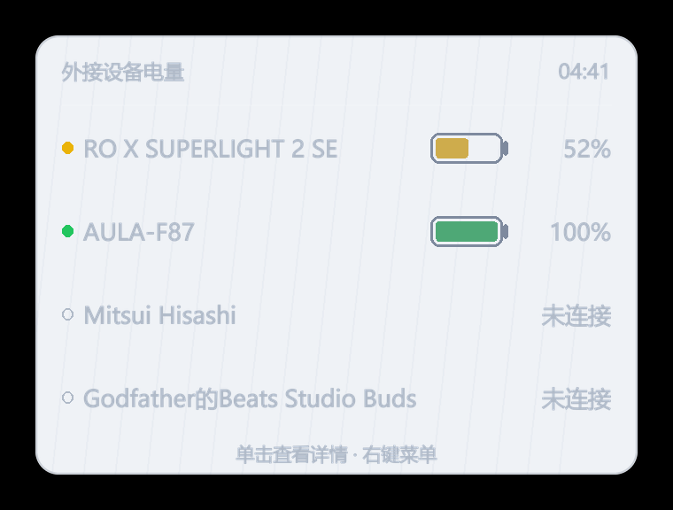
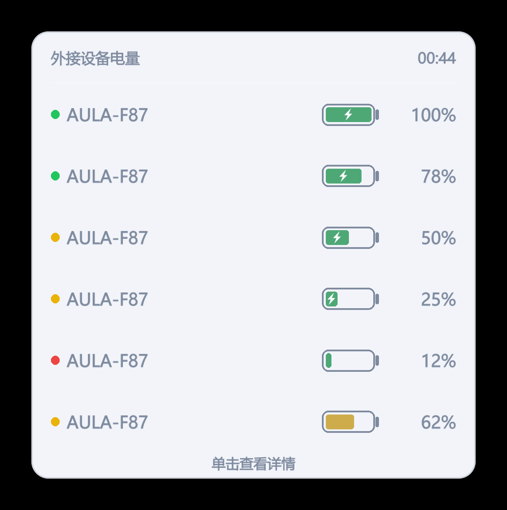

# Device Battery

**常驻系统托盘，一眼看到外接无线设备还剩多少电。**

软件名叫 **Device Battery**（中间有空格）。



Windows 自带的任务栏电池只显示「本机」电量。蓝牙键鼠、耳机、罗技 2.4G 设备各自还剩多少，系统不告诉你 —— 这个工具把这些数字汇总到一个托盘图标上，点一下展开竖列面板，每行一个设备。

- 托盘图标直接显示**最低电量**的百分比和颜色，不用点开就知道该充电了
- 左键单击弹面板，右键看明细 / 改检测间隔 / 开机自启
- 每 3 秒做一次轻量探测：**新连上的设备 3 秒内出现在面板，断开的 3 秒内收起**，再连上又回来
- 按「检测间隔」读硬件真实电量，中间按历史掉电速率线性估算，**不做轮询、不打扰设备休眠**
- 单实例：程序已在跑时再双击 exe = 把面板叫出来，不会开第二份
- 纯 ctypes 读硬件，打包后单文件 exe，无需安装 Python

## 能读哪些设备

| | 支持 | 说明 |
| --- | --- | --- |
| 蓝牙 / 蓝牙 LE | ✅ | 键盘、鼠标、耳机、手柄，只要设备向 Windows 上报了电量。走设备属性 `DEVPKEY_Bluetooth_Battery` |
| 罗技 2.4G（Unifying / Lightspeed） | ✅ | 直接读 HID++ 2.0，**不用装 G HUB**。特性 `0x1004 UNIFIED_BATTERY`（新固件）/ `0x1000 BATTERY_LEVEL_STATUS` |
| 狼蛛（AULA）2.4G | ✅ | 走接收器 3554:FA09 的私有报文（UsagePage 0xFF02），能拿到电量 + 充电状态 |
| 其他品牌 2.4G 私有协议 | ❌ | 七彩虹、雷蛇等只有厂商驱动能读，Windows 不对外暴露。这类设备不会出现在列表里，不是故障 |
| 双模设备（同一把键鼠同时有 2.4G 和蓝牙） | ✅ | **只显示当前正在用的那条链路**：2.4G 接收器还在应答就用 2.4G，拨到蓝牙后 8 秒内自动换成蓝牙。面板上设备名后面会标 `2.4G` / `蓝牙` |

## 安装与使用

1. 从 [**Releases**](https://github.com/Nuoili/device-battery-tray/releases/latest) 下载 `DeviceBattery-v1.0.6.exe`（下载后可以随手改名成 `Device Battery.exe`，程序不依赖文件名），放到任意文件夹（建议 `D:\Device Battery\`），双击启动。同一页还有 `DeviceBattery-Uninstaller-v1.0.6.bat`，改成 `Device Battery 卸载器.bat` 放进同一目录即可用
   > GitHub 的附件名不允许空格，会把它替换成点号，所以 Release 里统一用不带空格的写法；软件本身的名字始终是 `Device Battery`。
2. 图标默认在托盘 `^` 溢出区 —— 点开 `^`，按住图标拖到常显区松手即可固定
3. **左键单击** = 弹面板（再点一次收起，点面板外面也会收）；**右键** = 设置菜单

面板贴着**托盘图标**摆：正下方、且面板左边缘与图标左边缘对齐（`Shell_NotifyIconGetRect` 取图标精确矩形；任务栏在屏幕底部时自动翻到图标上方）。不跟鼠标指针跑。

### 桌面快捷方式

- 第一次启动（以及每次换新版本后第一次启动）会自动在**桌面**和开始菜单补一张 `Device Battery` 快捷方式；你手动删掉了就删掉了，同一版本内不会再重建
- 桌面路径走 `SHGetKnownFolderPath(FOLDERID_Desktop)`，所以桌面被重定向到别的盘（OneDrive 接管、自定义到 `E:\桌面` 之类）时也落在你看得见的那个桌面上，不会掉进 `%USERPROFILE%\Desktop` 这个空壳目录
- 想随时重做：右键托盘图标 → **创建快捷方式（桌面 + 开始菜单）**

## 电量颜色分级

| 电量 | 颜色 | 含义 |
| --- | --- | --- |
| < 25% | 🔴 红 | 该充电了 |
| 25% – 69% | 🟡 黄 | 够用，留意 |
| ≥ 70% | 🟢 绿 | 充裕 |



托盘、面板里的电池图形、右键菜单文字都按这个规则上色。充电时电池里会出现闪电标记。低电量会弹提醒，一轮放电最多三条（`<25%`、`<15%`、掉线），每条 5 秒后自动收回。

## 实测值 vs 估算值

- 每 **3 秒**读一次系统缓存里的蓝牙电量 + 蓝牙链路状态 + AULA 2.4G 接收器应答（实测一轮 48ms）；整轮硬件读数按「检测间隔」走（默认 60 分钟）
- 两次实测之间，用该设备历史上的掉电速度做线性外推（`估算`，界面里带 `≈` 前缀）
- 面板右上角写明「X 分钟前更新」

这样图标数值是缓慢下降的，到下一个整点被真实读数校正一次 —— 不需要一直连设备，也就不会打扰设备休眠。用得越久样本越多，估算越准；刚装上的头几小时没有历史，按 `0.5%/小时` 的默认速度先顶着。

## 从源码运行

```bash
pip install -r requirements.txt
python 源码/battery_tray.py --tray
```

`hidapi` 是可选的：缺了它罗技 HID++ 读不到，蓝牙设备照常工作（代码里是延迟导入 + 整体降级）。

### 命令行

```text
battery_tray.py            正常启动（有窗口即托盘）
battery_tray.py --tray     静默启动（供开机自启使用）
battery_tray.py --once     只读一次并打印，不驻留（排查用）
```

## 打包

```bat
pip install pyinstaller pystray pillow hidapi
python 源码/gen_icon.py "源码/Device Battery.ico"

python -m PyInstaller --onefile --noconsole --name "Device Battery" ^
  --icon "<源码目录绝对路径>\Device Battery.ico" ^
  --manifest "<源码目录绝对路径>\app.manifest" ^
  --collect-all hid --distpath .\dist --workpath .\build --specpath .\build ^
  源码/battery_tray.py
```

`--name` 直接用产品名（含空格），打出来就是 `Device Battery.exe`，程序内标题、任务管理器显示名、快捷方式默认名天然一致。

`--icon` / `--manifest` **必须写绝对路径**：PyInstaller 会按 `--specpath` 的相对路径去解析，写相对路径时打包会「成功」，但 dist 里生成一个几十 KB 的残缺 exe。

`app.manifest` 只做两件事：声明 PerMonitorV2 DPI 感知（高分屏下面板不发虚）、引用 comctl32 v6。没有它也能跑。

## 文件职责

| 文件 | 职责 |
| --- | --- |
| `battery_tray.py` | 托盘图标 + 右键菜单 + 定时采样线程 + 单实例与唤起 |
| `popup.py` | 左键弹的竖列面板（分层窗口 + Pillow 出图，纯 ctypes） |
| `icons.py` | 托盘图标绘制、电量分级配色、电池图形、菜单里的方块电池 |
| `hw_readers.py` | 蓝牙 / 罗技 HID++ / AULA 2.4G 私有协议 电量读取 |
| `state_store.py` | 状态持久化 + 掉电速率估算 |

## 实现要点

**单实例靠命名互斥体 + 命名事件。** `CreateMutexW` 的 `ERROR_ALREADY_EXISTS` 判断有个坑：必须用 `ctypes.WinDLL('kernel32', use_last_error=True)`，用 `ctypes.windll` 时 `ctypes.get_last_error()` 永远返回 0，判断恒为假。第二实例通过 `OpenEventW` + `SetEvent` 叫醒第一实例弹面板 —— 不用注册窗口类、不用写 WndProc，出错面更小。

**面板是分层窗口 + Pillow 实时出图。** 背景抠取屏幕后做高斯模糊、压一层 50% 深色，圆角 13px —— 磨砂玻璃质感，背后画面柔柔透出但看不清细节。想调手感改 `popup.py` 顶部：

```python
BACKDROP_OPACITY = 0.50   # 背板不透明度（0.3 更透，0.7 更实）
BACKDROP_BLUR    = 26.0   # 模糊半径，越大越糊
BACKDROP_RADIUS  = 13.0   # 圆角半径
```

**面板贴在托盘图标正下方、左边缘对齐。** `Shell_NotifyIconGetRect` 能直接用 —— pystray 注册图标时 `uID` 恒为 `0`（不是 `id(icon)`，实测传 id 会 E_FAIL），只要传对 `hWnd + uID=0` 就能拿到图标的精确矩形。拿到后 `x = 图标 left`、`y = 图标 bottom + 8`，下方放不下就翻到图标上方，再夹进图标所在那块屏的工作区（多显示器按 `MonitorFromPoint` 选屏）。取不到矩形才退回按任务栏对齐。

**双模设备只显示当前连接方式。** 同一把键盘同时存在 2.4G 和蓝牙两条链路时，面板只留一行，并标出这一行来自哪条链路。判断依据不是「蓝牙属性里有没有电量」—— 那个属性是缓存的，配对设备早就切回 2.4G 了它还在 —— 而是**接收器此刻还回不回数据**：AULA 2.4G 每 3 秒问一次，读不到就把显示让给蓝牙，最多 8 秒切过去；拨回 2.4G 则反过来，3 秒内切回来。

**离线即隐藏，连上就回来。** 3 秒一次的轻量探测拿一份蓝牙全量快照：快照里没有的设备、以及经典蓝牙链路已被系统判定断开的设备，**当次探测就判离线并从面板收起**（不留宽限期）；设备记录不删，再连上 3 秒内自动出现。想恢复宽限/关闭隐藏改 `state_store.py` 的 `OFFLINE_HIDE_SECONDS`（`0`=立即，负数=不隐藏）。

**「在线」判定分两条路。** 经典蓝牙（`BTHENUM\Dev_*`，A2DP 耳机音箱那类）走 `bthprops` 的 `fConnected` —— 实时可靠；BLE（`BTHLE\Dev_*`）不在它的枚举范围，只能按「电量属性还在」算在线。为什么必须这样：`DEVPKEY_Bluetooth_Battery` 是**缓存**的，耳机断开后属性里还留着断电前的电量（实测 Beats Studio Buds 断开后仍报 100%），只看属性会让已离线的设备一直挂在面板上。

**「在线」不看 `DEVPKEY_Device_IsConnected`。** 实测 BLE 耳机 / BLE 键鼠的这个属性恒为 0（LE 链路按需建立，读完电量就断），拿它判在线会把正在听歌的耳机判成离线。改用「能否读到 `DEVPKEY_Bluetooth_Battery`」：断开（关机 / 出配对）后这个属性会消失，和真实连接状态对得上。

## 数据与卸载

配置和历史上报都在 `%APPDATA%\Device Battery\`：

```text
config.json   设置（检测间隔、自启状态）
state.json    各设备电量历史（用于算掉电速率）
app.log       运行日志，出问题看这个
```

> 从 v1.0.4 及以前升级上来时，数据原本在 `%APPDATA%\DeviceBatteryTray\`。首次启动会自动把整个目录改名带过来（`state_store.migrate_legacy_dir`），配置和历史不丢。

彻底卸载：双击程序目录里的 **`Device Battery 卸载器.bat`**，它会结束进程、移除开机自启（HKCU Run 键 `Device Battery`，顺带清掉旧键名 `DeviceBatteryTray`）、删掉桌面与开始菜单的快捷方式（桌面按系统真实路径取，重定向到别的盘也能删干净）、把程序目录整个送进回收站，并单独问一句用户数据留不留。

手动卸载：右键托盘 → 退出 → 删 exe → 删 `%APPDATA%\Device Battery` 文件夹。开过自启的记得先在菜单里取消。

> 卸载器会先把「自己所在的文件夹」判定一遍（找 `Device Battery*.exe` / `DeviceBattery*.exe` / `BatteryTray*.exe` / `设备电量*.exe` 或 `源码\battery_tray.py`），认不出就拒绝执行 —— 防止把它误拷到别的目录后双击，把那个目录整个删掉。

## 资源占用

常驻内存约 20–30 MB。每 3 秒醒一次做轻量探测（读系统缓存属性 + 蓝牙链路状态 + AULA 2.4G 应答 + 枚举 HID 接口，实测一轮 48 毫秒，按 3 秒周期摊下来约 1.6% 单核，其余时间在睡）；整轮硬件读数按「检测间隔」走。除了向 AULA 接收器要一次电量（接收器自己应答，不唤醒键盘），不向无线设备发轮询请求。

## 许可

[MIT](LICENSE)
